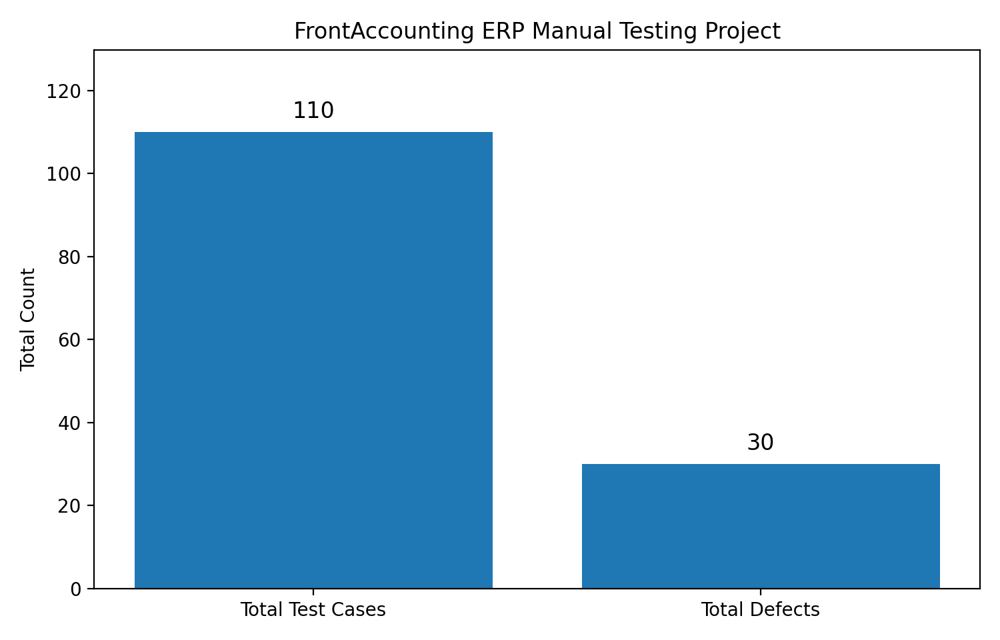

# FrontAccounting ERP Manual Testing Project

## Project Overview
This project documents manual testing of the FrontAccounting ERP application. The Excel workbook includes test scenarios, test cases, and a defect report.

## Project Metrics

| Metric | Total |
|---|---:|
| Total test cases | **110** |
| Total defects found | **30** |

## Defect Types
The defect report records **30 defects** in total. The defect types recorded in the workbook should be reviewed against the defect report sheet before publishing a type-by-type breakdown; this README does not assume a breakdown beyond the confirmed total.

## Test Cases vs. Defects

The bar chart compares the total number of documented test cases (110) with the total number of recorded defects (30). A defect is not necessarily linked one-to-one with a test case.

## Workbook Sections
- **Introduction** — project/application overview
- **Test Scenario** — test scenarios and conditions
- **Test Case** — manual test cases and execution details
- **Defect Report** — defect IDs, details, and tracking information

## Note
The totals above use the corrected project figures: **110 test cases and 30 defects**.
